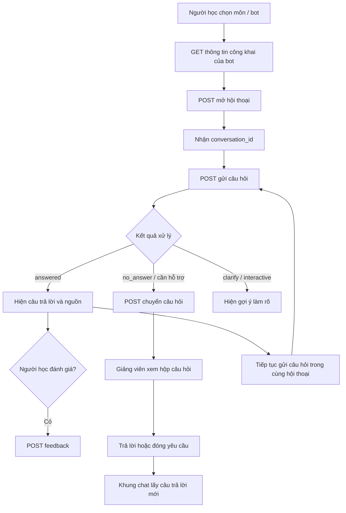
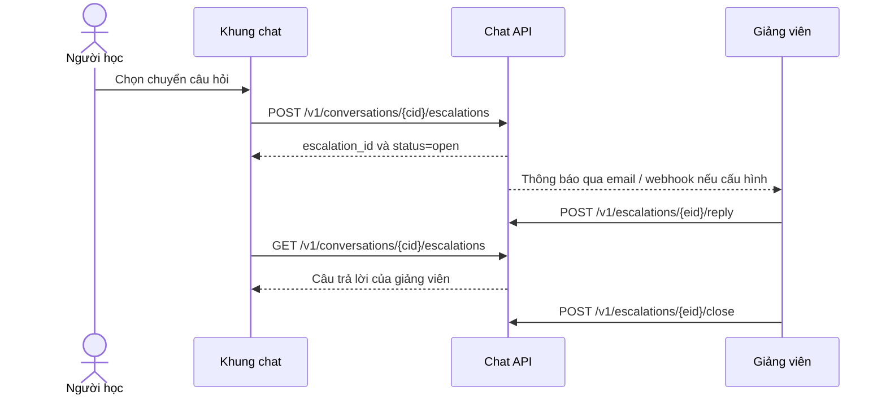
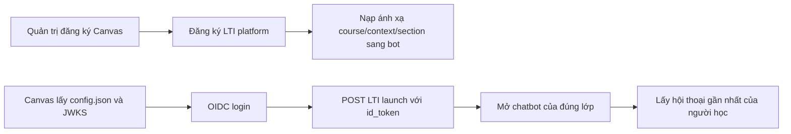

# DHQG MOOC Chatbot — Luồng hệ thống và danh mục API

Tài liệu này tóm tắt cách các thành phần tích hợp với DHQG MOOC Chatbot, các luồng sử dụng chính và danh mục endpoint trong OpenAPI **cap-chatbot 0.13.0**.

## 1. Tổng quan hệ thống

| Thành phần | Vai trò |
|---|---|
| **Canvas / LMS** | Nơi người học mở chatbot của lớp qua LTI. |
| **Ứng dụng tích hợp** | Giao diện chat hoặc hệ thống đối tác gọi API. Ví dụ trong `Instructor.MD`: `chat.html`, `server.js`, widget. |
| **Chat API** | Quản lý bot, hội thoại, tin nhắn, phản hồi, chuyển giảng viên và báo cáo. |
| **Kho tri thức** | Nội dung khóa học và lời giảng video đã được chuyển thành văn bản để bot tra cứu. |
| **Giảng viên / người phụ trách** | Nhận câu hỏi cần hỗ trợ, trả lời hoặc đóng yêu cầu chuyển tiếp. |

**API gốc:** `https://platform.n2nai.io/chat`

**Xác thực phổ biến:**

```http
Authorization: Bearer <CAP_API_KEY>
Content-Type: application/json
```

Giữ khóa bí mật ở máy chủ tích hợp. Không đưa `CAP_API_KEY` vào JavaScript phía trình duyệt, ứng dụng di động, mã nguồn công khai hoặc log. Widget dùng loại khóa công khai được cấp riêng; khóa công khai chỉ hoạt động trên các origin đã cấu hình.

## 2. Bản đồ luồng chính



### Luồng hỏi đáp cơ bản

1. Chọn `bot` tương ứng với môn học.
2. Lấy cấu hình hiển thị công khai của bot nếu giao diện cần lời chào, câu hỏi gợi ý hoặc chế độ.
3. Mở hội thoại bằng `user_ref`; lưu `conversation_id` trả về.
4. Gửi câu hỏi đến hội thoại đó. Có thể gửi nhiều câu hỏi để giữ ngữ cảnh.
5. Hiển thị `answer` và các nguồn phù hợp; nếu cần, cho phép người học đánh giá hoặc chuyển câu hỏi cho giảng viên.

## 3. Các mã bot môn học

| Mã bot | Môn học |
|---|---|
| `lich-su-dang-249` | Lịch sử Đảng |
| `triet-hoc-mac-lenin-250` | Triết học Mác - Lênin |
| `tu-tuong-ho-chi-minh-270` | Tư tưởng Hồ Chí Minh |
| `chu-nghia-xa-hoi-khoa-hoc-259` | Chủ nghĩa xã hội khoa học |
| `kinh-te-chinh-tri-mac-lenin-265` | Kinh tế chính trị Mác - Lênin |
| `kien-truc-may-tinh-242` | Kiến trúc máy tính |
| `truc-quan-hoa-du-lieu-164` | Trực quan hóa dữ liệu |
| `dai-so-tuyen-tinh-273` | Đại số tuyến tính |
| `kinh-te-vi-mo-240` | Kinh tế vĩ mô |
| `phap-luat-dai-cuong-266` | Pháp luật đại cương |

Phần số trong mã bot thường là `canvas_course_id`. Kho tri thức gồm nội dung khóa học không có đáp án và lời giảng video đã chuyển thành văn bản tự động. Bản chép lời tự động có thể nhận dạng sai tên riêng hoặc số liệu.

## 4. API hỏi đáp và nội dung bot

`{key}` là mã bot; `{cid}` là `conversation_id`; `{mid}` là `message_id`.

| Phương thức | Endpoint | Dùng để |
|---|---|---|
| `GET` | `/v1/bots/{key}/public` | Lấy tên, ngôn ngữ, lời chào, câu gợi ý, chế độ và cấu hình hiển thị công khai. |
| `POST` | `/v1/bots/{key}/conversations` | Mở hội thoại mới; gửi `user_ref`, nhận `conversation_id`. |
| `POST` | `/v1/conversations/{cid}/messages` | Gửi câu hỏi và nhận câu trả lời. |
| `GET` | `/v1/conversations/{cid}` | Đọc lịch sử một hội thoại theo quyền truy cập. |
| `GET` | `/v1/bots/{key}/conversations/latest` | Lấy hội thoại gần nhất của người học trong phiên LTI. |
| `GET` | `/v1/messages/{mid}/trace` | Truy vết câu trả lời, cấu hình bot và các đoạn tài liệu đã dùng. |
| `POST` | `/v1/messages/{mid}/feedback` | Gửi đánh giá cho một câu trả lời. |

### Payload cơ bản

Mở hội thoại:

```http
POST /v1/bots/kinh-te-vi-mo-240/conversations
```

```json
{"user_ref":"u_8f3a1c"}
```

Phản hồi thành công có HTTP `201`, gồm `conversation_id`, `greeting`, `suggested_questions` và `mode`.

Gửi câu hỏi:

```http
POST /v1/conversations/{conversation_id}/messages
```

```json
{"text":"Chính sách tiền tệ là gì?","stream":false}
```

`text` dài từ 1 đến 4000 ký tự. Để nhận câu trả lời theo từng đoạn SSE, đặt `stream: true`.

### Kết quả trả lời

Phản hồi có thể gồm `message_id`, `status`, `answer`, `citations[]`, `actions[]`, `interactive`, `conversation_id`, `redirect_rule`, `resolved_mode` và `truncated`.

| `status` | Ý nghĩa trong giao diện |
|---|---|
| `answered` | Đã có câu trả lời dựa trên tài liệu. |
| `no_answer` | Không tìm thấy thông tin hoặc câu hỏi ngoài phạm vi; có thể gợi ý chuyển giảng viên. |
| `redirected` | Câu hỏi được điều hướng theo quy tắc. |
| `deferred` | Câu hỏi xin ý kiến cá nhân được trì hoãn hoặc chuyển hướng. |
| `handoff` | Người học muốn gặp người hỗ trợ. |
| `blocked` | Câu hỏi bị chặn theo quy tắc nội dung. |
| `error` | Có lỗi khi xử lý. |

Nguồn trong `citations[]` có thể chứa `title`, `section`, `excerpt`, `snippet`, `source_url`, `position`, `document_id` và `collection`. Nên hiển thị `title` và `section`; không hiển thị `score` vì đây là điểm liên quan nội bộ.

Khi dùng SSE, các sự kiện có thể gồm `delta`, `mode`, `citations`, `done`, `error` và `rate_limited`. Khi nhận `done`, đồng bộ giao diện với `done.answer` để lấy nội dung cuối đầy đủ.

## 5. Chuyển câu hỏi cho giảng viên



| Phương thức | Endpoint | Dùng để |
|---|---|---|
| `POST` | `/v1/conversations/{cid}/escalations` | Chuyển một câu hỏi cho người phụ trách. |
| `GET` | `/v1/conversations/{cid}/escalations` | Khung chat lấy trạng thái và câu trả lời đã có. |
| `GET` | `/v1/bots/{key}/escalations` | Hộp yêu cầu chuyển giảng viên; hỗ trợ lọc và phân trang. |
| `GET` | `/v1/bots/{key}/escalations/export.xlsx` | Xuất hộp chuyển tiếp ra Excel. |
| `GET` | `/v1/escalations/{eid}` | Xem một yêu cầu cùng lịch sử liên quan. |
| `POST` | `/v1/escalations/{eid}/reply` | Giảng viên trả lời người học. |
| `POST` | `/v1/escalations/{eid}/close` | Đóng yêu cầu; đã đóng thì không trả lời thêm. |

Việc tạo escalation gửi câu hỏi kèm tối đa 10 lượt gần nhất và có thể thông báo qua email hoặc webhook nếu đã cấu hình. Gửi lại cùng `message_id` không tạo yêu cầu chuyển tiếp thứ hai.

## 6. Biểu mẫu liên hệ và đánh giá bot

### Biểu mẫu liên hệ

| Phương thức | Endpoint | Dùng để |
|---|---|---|
| `GET` | `/v1/bots/{key}/lead-form` | Lấy cấu hình biểu mẫu công khai; trả `404` nếu bot chưa bật biểu mẫu. |
| `POST` | `/v1/bots/{key}/leads` | Gửi thông tin từ biểu mẫu; có thể gửi webhook/email nếu cấu hình. |
| `GET` | `/v1/bots/{key}/leads` | Xem danh sách biểu mẫu đã gửi; chỉ khóa bí mật. |
| `GET` | `/v1/bots/{key}/leads/export.xlsx` | Xuất thông tin liên hệ ra Excel; chỉ khóa bí mật. |

`delivery` của lead có thể là `delivered`, `partial` hoặc `stored` (chỉ lưu).

### Đánh giá chất lượng bot

| Phương thức | Endpoint | Dùng để |
|---|---|---|
| `POST` | `/v1/bots/{key}/eval` | Khởi chạy đánh giá bằng bộ câu hỏi; trả HTTP `202`. |
| `GET` | `/v1/bots/{key}/eval` | Liệt kê các lượt đánh giá. |
| `GET` | `/v1/bots/{key}/eval/{job_id}` | Xem một lượt đánh giá; có thể yêu cầu kèm kết quả. |
| `GET` | `/v1/bots/{key}/eval/{job_id}/report.xlsx` | Xuất báo cáo đánh giá ra Excel. |

## 7. Quản trị bot và tenant

### Quản trị bot

| Phương thức | Endpoint | Dùng để |
|---|---|---|
| `POST` | `/v1/bots` | Tạo bot. |
| `GET` | `/v1/bots` | Liệt kê bot. |
| `GET` | `/v1/bots/{key}` | Xem cấu hình bot. |
| `PATCH` | `/v1/bots/{key}` | Cập nhật cấu hình bot. |
| `DELETE` | `/v1/bots/{key}` | Xóa bot. |
| `POST` | `/v1/bots/{key}/rotate-webhook-secret` | Đổi webhook secret. |
| `POST` | `/v1/bots/{key}/publishable-key` | Tạo/đổi khóa công khai `cap_cb_pub_`; khóa cũ hết hiệu lực ngay. |
| `DELETE` | `/v1/bots/{key}/publishable-key` | Thu hồi khóa công khai. |

Muốn cấp khóa công khai, bot phải có `allowed_origins`. Khóa này chỉ dùng cho các chức năng khung chat từ origin đã cho phép.

### Quản trị tenant

Các endpoint tenant dùng header `x-admin-token` theo đặc tả:

| Phương thức | Endpoint | Dùng để |
|---|---|---|
| `POST` | `/admin/tenants` | Tạo tenant. |
| `GET` | `/admin/tenants` | Liệt kê tenant. |
| `PATCH` | `/admin/tenants/{tid}` | Cập nhật tenant. |
| `POST` | `/admin/tenants/{tid}/rotate-key` | Đổi khóa bí mật tenant. |
| `GET` | `/health` | Kiểm tra dịch vụ còn hoạt động. |

## 8. Khóa truy cập, log và giám sát

### Quản lý khóa

| Phương thức | Endpoint | Dùng để / quyền chính |
|---|---|---|
| `POST` | `/v1/keys` | Tạo khóa phụ; chỉ khóa toàn quyền. Khóa trả một lần. |
| `GET` | `/v1/keys` | Liệt kê khóa phụ; chỉ khóa toàn quyền. |
| `DELETE` | `/v1/keys/{kid}` | Thu hồi khóa phụ; chỉ khóa toàn quyền. |
| `POST` | `/v1/api-keys` | Tạo khóa API `cap_cb_int_`; chỉ khóa toàn quyền. |
| `GET` | `/v1/api-keys` | Liệt kê khóa API; không trả chuỗi khóa. |
| `GET` | `/v1/api-keys/{kid}/reveal` | Xem lại khóa API nếu được mã hóa để lưu; thao tác được ghi audit. |
| `PATCH` | `/v1/api-keys/{kid}` | Sửa tên, ghi chú, phạm vi bot, hạn dùng hoặc giới hạn lượt/phút. |
| `DELETE` | `/v1/api-keys/{kid}` | Thu hồi khóa API; có hiệu lực ngay. |
| `GET` | `/v1/audit` | Xem nhật ký kiểm toán; chỉ khóa toàn quyền. |

Khóa phụ chỉ hiển thị một lần khi tạo. Khóa API chỉ xem lại được khi dịch vụ có cấu hình mã hóa phù hợp; khóa cũ tạo trước phiên bản hỗ trợ có thể không reveal được.

### Log và số liệu vận hành

| Phương thức | Endpoint | Dùng để |
|---|---|---|
| `GET` | `/v1/api-metrics` | Xem lượt gọi, lỗi, độ trễ và chi phí theo đường API, ngày giờ và khóa. |
| `GET` | `/v1/api-logs` | Tìm lịch sử gọi API; hỗ trợ lọc theo khóa, route, method, status và bot. |
| `GET` | `/v1/api-logs/{log_id}` | Xem chi tiết một lần gọi, gồm request/response đã lưu và cờ cắt dữ liệu. |

Log danh sách không chứa body request/response; endpoint chi tiết mới trả phần nội dung đã được lưu, có thể bị cắt theo giới hạn kích thước.

## 9. Thống kê và xuất báo cáo

| Phương thức | Endpoint | Dùng để |
|---|---|---|
| `GET` | `/v1/bots/{key}/stats` | Thống kê một bot. |
| `GET` | `/v1/stats` | Thống kê tổng hợp theo bot, môn, lớp hoặc ngày. |
| `GET` | `/v1/stats/export.xlsx` | Xuất thống kê tổng hợp ra Excel. |
| `GET` | `/v1/report.xlsx` | Báo cáo Excel cho nhiều bot. |
| `GET` | `/v1/bots/{key}/report.xlsx` | Báo cáo Excel của một bot. |
| `GET` | `/v1/bots/{key}/conversations/export.xlsx` | Xuất hội thoại ra Excel; dữ liệu cá nhân được che theo cấu hình. |
| `PUT` | `/v1/stats/groups` | Thay bảng ánh xạ bot sang môn/lớp. |
| `GET` | `/v1/stats/groups` | Xem bảng ánh xạ bot sang môn/lớp. |

Các truy vấn thống kê hỗ trợ lọc thời gian và bot. Mã bot trong danh sách có thể dùng tiền tố kết thúc bằng `*`; bỏ trống danh sách bot thì lấy tất cả theo quyền truy cập.

## 10. Tích hợp Canvas LTI 1.3



| Phương thức | Endpoint | Dùng để |
|---|---|---|
| `POST` | `/v1/lti/platforms` | Đăng ký nền tảng LTI (Canvas). |
| `GET` | `/v1/lti/platforms` | Liệt kê nền tảng đã đăng ký. |
| `PATCH` | `/v1/lti/platforms/{pid}` | Cập nhật nền tảng. |
| `DELETE` | `/v1/lti/platforms/{pid}` | Xóa nền tảng. |
| `POST` | `/v1/lti/mappings` | Nạp ánh xạ khóa học Canvas sang bot lớp. |
| `GET` | `/v1/lti/mappings` | Xem các ánh xạ. |
| `DELETE` | `/v1/lti/mappings/{mid}` | Xóa một ánh xạ. |
| `GET` | `/lti/jwks` | Cung cấp public keys của tool. |
| `GET` | `/lti/config.json` | Lấy cấu hình để khai báo Developer Key trong Canvas. |
| `GET`, `POST` | `/lti/login` | Nhận yêu cầu đăng nhập OIDC từ nền tảng. |
| `POST` | `/lti/launch` | Nhận `id_token` và mở chatbot đúng bot lớp. |

LTI 1.3 là luồng tích hợp riêng, không dùng các endpoint API key để thay thế đăng nhập Canvas.

## 11. API chính thức và endpoint của ứng dụng mẫu

OpenAPI mô tả API dịch vụ với các đường dẫn `/v1/...`, `/admin/...` và `/lti/...`. Trong ví dụ `server.js`, giao diện `chat.html` gọi các endpoint proxy do ứng dụng mẫu tự cung cấp:

| Endpoint ứng dụng mẫu | Tác dụng |
|---|---|
| `GET /`, `/chat.html`, `/index.html` | Trả giao diện chat. |
| `GET /api/bots` | Trả danh sách bot tĩnh cho giao diện mẫu. |
| `POST /api/start` | Proxy mở hội thoại qua API dịch vụ. |
| `POST /api/message` | Proxy gửi câu hỏi qua API dịch vụ. |
| `GET /widget.html` | Trả trang thử widget. |

Các endpoint `/api/...` này là route của máy chủ mẫu, không phải endpoint được khai báo trong OpenAPI. `server.js` giữ `CAP_API_KEY` ở phía máy chủ rồi gọi API dịch vụ thay cho trình duyệt.

## 12. Định danh, giới hạn và lỗi

### `user_ref`

`user_ref` dùng để liên kết hội thoại của cùng người học. Đặc tả cho phép tối đa 200 ký tự và khuyến nghị dùng mã ổn định đã băm thay cho MSSV, họ tên hoặc email. Có thể dùng HMAC-SHA256 ở máy chủ; giữ secret riêng với `CAP_API_KEY`. Thiếu `user_ref` khi mở hội thoại sẽ nhận `422 user_ref_required`.

### Một số giới hạn nêu trong hướng dẫn

| Giới hạn | Giá trị |
|---|---:|
| Mặc định mỗi khóa | 120 lượt/phút |
| Cổng công khai theo IP | 300 lượt/phút, burst tối đa 100 |
| Kích thước body | 64 KB |
| Câu hỏi | 1–4000 ký tự |
| Thời gian chờ tối đa theo đặc tả | 120 giây |
| Chuyển giảng viên mặc định | 10 câu/giờ/hội thoại |

Giới hạn thực tế có thể tùy cấu hình khóa hoặc bot. Khi nhận `429`, đọc `Retry-After` hoặc `retry_after` trước khi thử lại.

### Mã HTTP thường gặp

| HTTP | Diễn giải |
|---:|---|
| `401` | Thiếu, sai, hết hạn hoặc đã thu hồi khóa. |
| `403` | Khóa sai định dạng, không được phép dùng bot hoặc thiếu quyền. |
| `404` | Không tìm thấy đường dẫn, hội thoại, tin nhắn hoặc tính năng chưa bật. |
| `409` | Trạng thái xung đột, chẳng hạn bot đã tắt hoặc escalation đã đóng. |
| `413` | Request vượt giới hạn body. |
| `422` | Thiếu trường bắt buộc hoặc request không hợp lệ. |
| `429` | Vượt giới hạn lượt gọi; xem thời gian chờ. |
| `502`, `503`, `504` | Dịch vụ phía sau không sẵn sàng hoặc quá thời gian. |

Lỗi có dạng `{"error":{"code":"...","message":"...","request_id":"..."}}`. Khi báo sự cố, cung cấp `request_id`, thời điểm và endpoint; không gửi khóa. Có thể retry lỗi `502/503/504` với backoff tăng dần; tránh tự lặp lỗi `4xx` trừ khi đã xử lý nguyên nhân hoặc chờ theo `429`.

## 13. Lưu ý nội dung và trải nghiệm

- Bot **Chủ nghĩa xã hội khoa học** có kho tri thức mỏng, chủ yếu là phần giới thiệu môn.
- Bot **Trực quan hóa dữ liệu** dùng bài giảng tiếng Anh và trả lời bằng tiếng Việt; chất lượng chép lời còn thấp, cần kiểm tra kỹ câu trả lời dựa trên lời giảng.
- Bot **Pháp luật đại cương** hiện chưa có Chương 8.
- Lời giảng tự động ở mọi môn có thể nhận dạng nhầm tên riêng hoặc số liệu.
- Bot không cung cấp đáp án bài kiểm tra.

## 14. Tham khảo nhanh

```text
BASE_URL = https://platform.n2nai.io/chat

Lấy cấu hình bot:       GET  /v1/bots/{key}/public
Mở hội thoại:           POST /v1/bots/{key}/conversations
Gửi câu hỏi:            POST /v1/conversations/{cid}/messages
Gửi đánh giá:           POST /v1/messages/{mid}/feedback
Chuyển giảng viên:      POST /v1/conversations/{cid}/escalations
Xem hội thoại:          GET  /v1/conversations/{cid}
Lấy câu trả lời trace:  GET  /v1/messages/{mid}/trace
Canvas LTI launch:      POST /lti/launch
```
