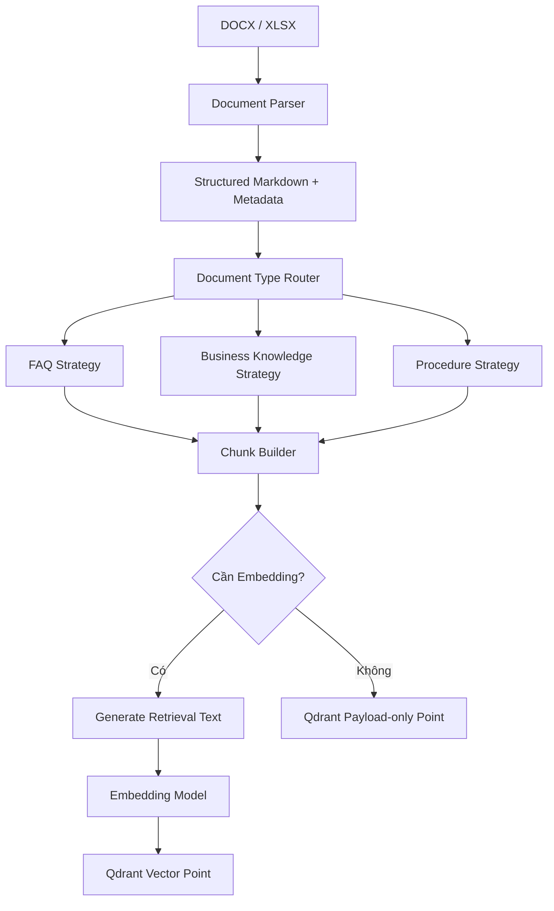
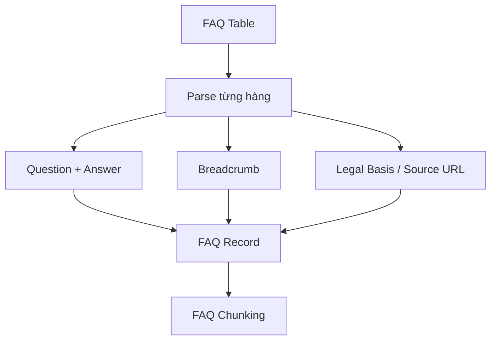
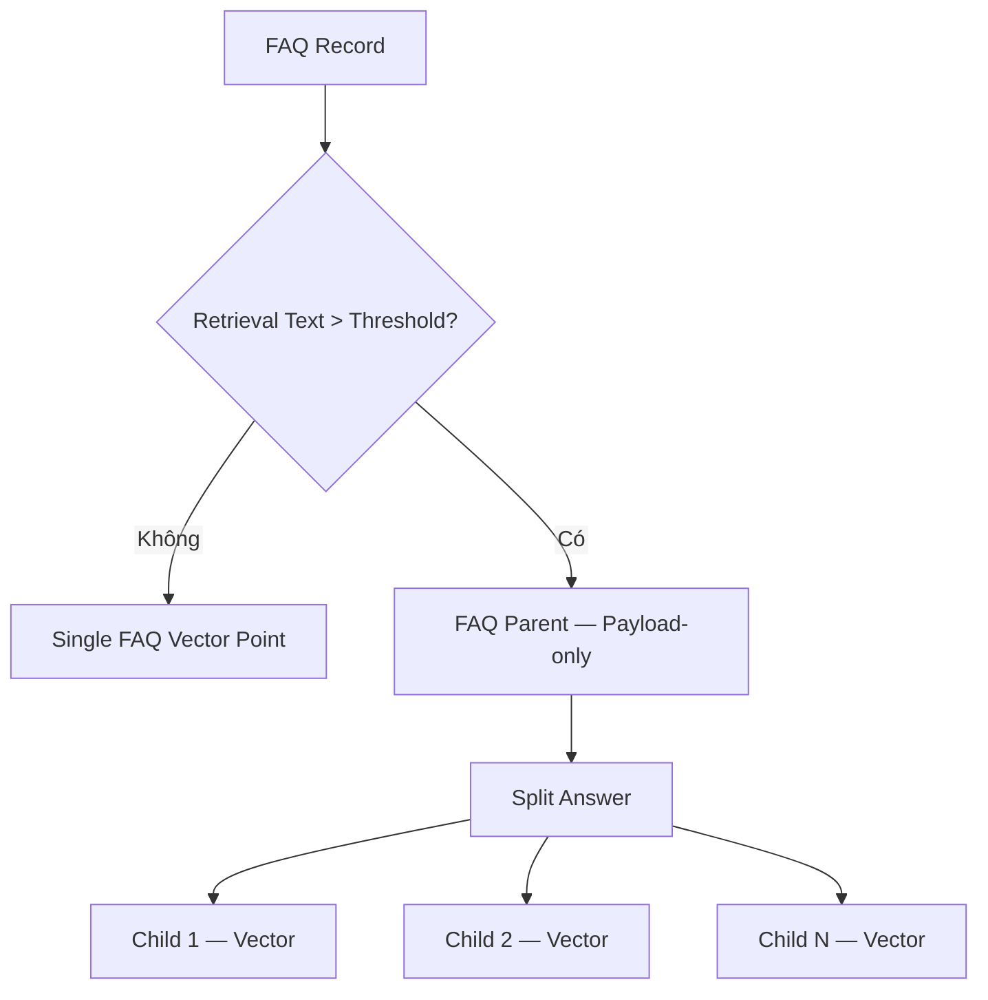
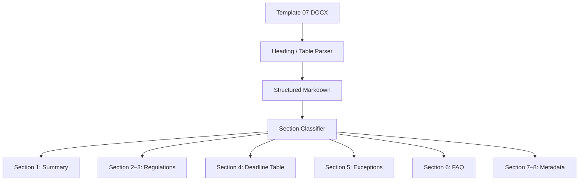
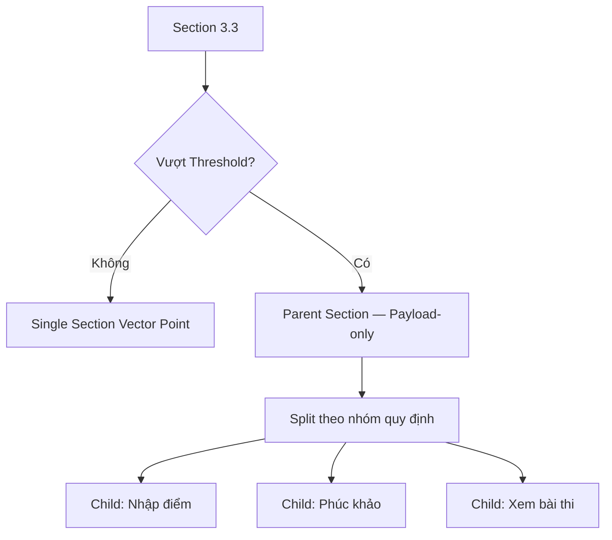
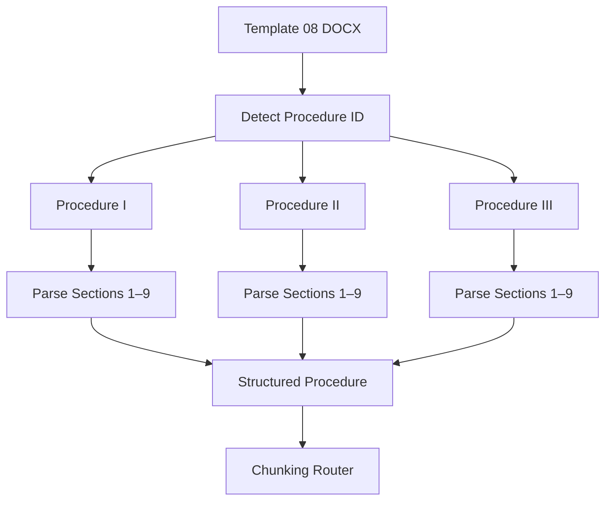
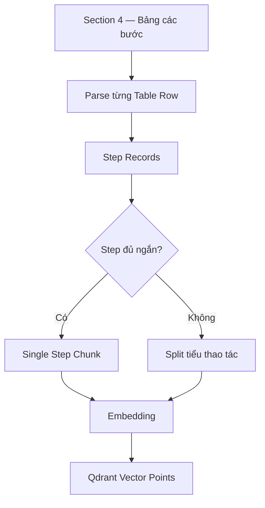
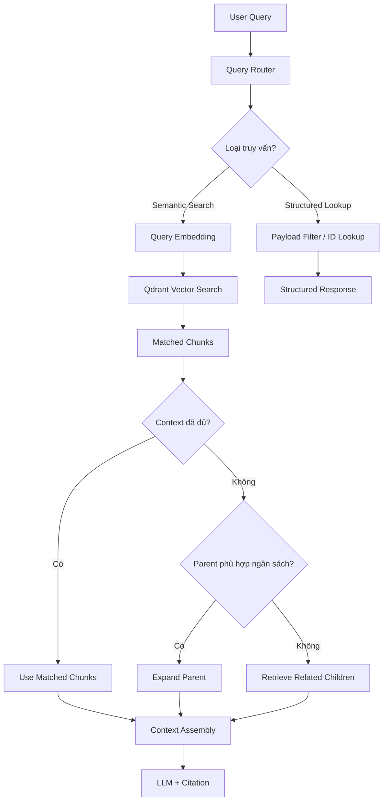
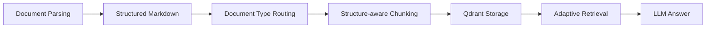

# ĐẶC TẢ KỸ THUẬT: DOCUMENT PARSING & CHUNKING STRATEGY

**Phạm vi:** Template 06 — FAQ, Template 07 — Tài liệu nghiệp vụ chuẩn hóa, Template 08 — Quy trình, thủ tục.

**Kiến trúc:** DOCX → Structured Markdown → Chunking → Qdrant → Retrieval → LLM.

**Định hướng:** Bảo toàn cấu trúc tài liệu, giảm tình trạng chia mất ngữ cảnh, hạn chế dữ liệu trùng lặp và tối ưu số token truyền vào LLM.

---

# I. KIẾN TRÚC TỔNG THỂ

## 1. Mục tiêu

Thay vì sử dụng một chiến lược chung là Fixed-size Chunking + Overlap cho tất cả tài liệu, hệ thống sẽ lựa chọn chiến lược dựa trên đặc tính của dữ liệu.

Ví dụ:

- FAQ: chia theo từng cặp Question–Answer.
- Quy định nghiệp vụ: chia theo Section.
- Bảng dữ liệu: chia theo từng Record.
- Quy trình: chia theo từng Procedure, Section và Step.
- Ngoại lệ: chia theo tình huống.
- Nội dung quá dài: áp dụng Parent–Child.

**Nguyên tắc quan trọng:** Ranh giới ngữ nghĩa được ưu tiên hơn ranh giới token. Token Threshold chỉ quyết định khi nào cần chia nhỏ thêm.

## 2. Pipeline tổng thể



Pipeline gồm hai công đoạn khác nhau:

1. **Parsing:** Chuyển DOCX thành dữ liệu Markdown có cấu trúc, đồng thời trích xuất metadata.
2. **Chunking:** Chia dữ liệu đã chuẩn hóa thành các đơn vị tri thức phù hợp với Semantic Search.

Không nên gộp hai công đoạn này thành một thao tác chia text đơn giản.

## 3. Chiến lược theo loại dữ liệu

| Loại dữ liệu | Primary Strategy | Secondary Strategy |
|---|---|---|
| FAQ | QA Record-based | Parent–Child |
| Quy định theo mục | Section-based | Parent–Child |
| Bảng thời hạn, điều kiện | Record-based | Parent–Child |
| Ngoại lệ, tình huống | Semantic / Case-based | Parent–Child |
| Quy trình, thủ tục | Procedure-aware | Section-based |
| Các bước thực hiện | Step-based | Parent–Child |
| Summary, nguồn, metadata | Metadata Extraction | Payload Filtering |
| Văn bản không nhận diện được cấu trúc | Fixed-size | Overlap |

---

# II. QUY CHUẨN PARSING: DOCX → MARKDOWN

## 1. Mục đích của Parsing

DOCX chứa nhiều thành phần khác nhau:

- Heading.
- Paragraph.
- Ordered/Unordered List.
- Table.
- Hyperlink.
- Các đối tượng như mã quy trình, mã FAQ, căn cứ pháp lý.

Parser cần chuyển các thành phần này thành Markdown có cấu trúc để Chunking Engine xử lý.

### Ví dụ

**Đầu vào DOCX**

```text
3.3. Chấm, nhập, khóa điểm; phúc khảo và xem bài thi

Đăng ký phúc khảo ĐHCQ: 02 ngày làm việc.
Đăng ký phúc khảo SĐH: 07 ngày làm việc.

Căn cứ pháp lý: Khoản 2 Điều 14,
Quyết định 3388/QĐ-ĐHKTL.
```

**Đầu ra Markdown**

```markdown
### 3.3. Chấm, nhập, khóa điểm; phúc khảo và xem bài thi

- Đăng ký phúc khảo ĐHCQ: 02 ngày làm việc.
- Đăng ký phúc khảo SĐH: 07 ngày làm việc.

**Căn cứ pháp lý:**
Khoản 2 Điều 14, Quyết định 3388/QĐ-ĐHKTL.
```

Đây là ví dụ rút gọn để minh họa, không phải toàn văn Mục 3.3.

## 2. Các quy tắc Parsing

| Thành phần DOCX | Cách chuyển đổi | Yêu cầu |
|---|---|---|
| Heading | `#`, `##`, `###` | Giữ đúng phân cấp |
| Paragraph | Markdown Paragraph | Giữ nội dung, thứ tự |
| List | Markdown List | Giữ thứ tự và cấp lồng nhau |
| Table | Markdown Table hoặc Structured Record | Không mất thông tin hàng/cột |
| Hyperlink | Markdown Link | Giữ URL thật |
| Căn cứ pháp lý | Tách thành field metadata | Giữ nguyên văn căn cứ gốc |
| FAQ-ID | Trích xuất mã | Không tự sinh mã khác |
| Procedure-ID | Trích xuất mã | Xác định ranh giới quy trình |
| Lịch sử phiên bản | Structured Metadata | Không embedding mặc định |

**Lưu ý:** Markdown không biểu diễn tốt mọi bảng Word có ô gộp. Đối với bảng phức tạp, cần lưu thêm cấu trúc hàng/cột dưới dạng JSON hoặc AST, thay vì chỉ phụ thuộc vào bảng Markdown.

## 3. Bảo toàn dữ liệu

Parser phải bảo đảm:

- Không mất hoặc đảo thứ tự các đoạn.
- Không tách rời các ô thuộc cùng một hàng.
- Không mất URL.
- Không nhầm Heading với Paragraph.
- Không biến dữ liệu chưa xác định thành giá trị mặc định.
- Giữ được `source_locator` để xác định vị trí trong tài liệu nguồn.

---

# III. CẤU TRÚC CHUNK CHUNG

## 1. Qdrant Vector Point

Vector Point được sử dụng khi nội dung cần Semantic Search.

```json
{
  "id": "f26a4c5f-90d8-4e1b-9637-e593f41ab9f4",
  "vector": [0.12, -0.08, 0.31],
  "payload": {
    "record_type": "knowledge_chunk",
    "chunk_id": "KT-T07-S3.3-C01",
    "document_id": "KT-T07",
    "department_id": "bdcl",
    "document_type": "business_knowledge",
    "content": "Nội dung nghiệp vụ...",
    "retrieval_text": "Breadcrumb > Nội dung nghiệp vụ...",
    "parent_id": null,
    "section_id": "3.3",
    "document_version": "2.2",
    "approval_status": "approved",
    "source_locator": {
      "section": "3.3"
    }
  }
}
```

Vector ở trên được rút gọn để minh họa. Trong thực tế, số chiều phải phù hợp với Embedding Model.

## 2. Qdrant Payload-only Point

Payload-only Point dùng cho dữ liệu không cần Embedding.

```json
{
  "id": "d86ab0e3-d9a1-49d8-a48f-62e4e754d290",
  "vector": {},
  "payload": {
    "record_type": "document_metadata",
    "document_id": "KT-T07",
    "title": "Quy định công tác khảo thí",
    "summary": "Tài liệu tổng hợp quy định về công tác khảo thí.",
    "document_version": "2.2"
  }
}
```

**Lưu ý triển khai:** Với collection dùng unnamed vectors, có thể tạo point không truyền trường vector. Với named-vector collection, `vector: {}` biểu diễn không có named vector nào. Cần kiểm thử theo collection schema và phiên bản Qdrant thực tế.

## 3. Phân biệt ba trường quan trọng

| Field | Mục đích |
|---|---|
| `content` | Nội dung dùng làm context cho LLM |
| `retrieval_text` | Nội dung được đưa qua Embedding Model |
| `metadata` | Định danh, nguồn, trạng thái, phân loại, quan hệ |

Về mặt Qdrant, `content`, `retrieval_text` và các trường metadata đều có thể được đặt trong `payload`. Không nhất thiết phải tạo thêm một object `metadata` lồng bên trong.

---

# IV. TEMPLATE 06 — FAQ

## 1. Đặc tính dữ liệu

FAQ có cấu trúc bảng, mỗi Record chứa:

- `FAQ_ID`
- `Breadcrumb`
- `Question`
- `Answer`
- `Legal_Basis` — đề xuất bổ sung.
- `Source_URL` — nếu có.

**Đề xuất:** Tách Căn cứ pháp lý khỏi Answer để phục vụ trích dẫn, tránh việc LLM phải tự suy luận căn cứ pháp lý từ câu trả lời.

Việc bổ sung trường này không đồng nghĩa được tự động xóa căn cứ khỏi nội dung Answer gốc. Cần kiểm tra và chuẩn hóa trước.

## 2. Parsing Strategy

**Primary Parser:** Table-to-Record Parser.

Một hàng FAQ được chuyển thành một Record độc lập.



## 3. Chunking Strategy

**Primary:** QA Record-based Chunking.

Mỗi FAQ là một đơn vị tri thức.

```text
content = Answer

retrieval_text =
    Breadcrumb
    + Question
    + Answer
```

### Trường hợp 1 — Không vượt Token Threshold

Tạo một Vector Point cho FAQ.

```json
{
  "chunk_id": "KT-FAQ-005-C01",
  "content": "Điểm I có hiệu lực 01 năm kể từ ngày nhận.",
  "retrieval_text": "Khảo thí > Điểm I > Hiệu lực điểm I\nQuestion: Điểm I có giá trị trong bao lâu?\nAnswer: Điểm I có hiệu lực 01 năm kể từ ngày nhận.",
  "faq_id": "KT-FAQ-005",
  "chunk_type": "faq_single",
  "parent_id": null,
  "legal_basis_text": "Phụ lục 16, Quyết định 3388/QĐ-ĐHKTL"
}
```

Payload này chỉ minh họa cơ chế; dữ liệu triển khai phải lấy Answer nguyên văn đã được duyệt.

### Trường hợp 2 — Vượt Token Threshold

Áp dụng Parent–Child Chunking.

**Parent:** Lưu toàn bộ Question và Answer dưới dạng Payload-only Point.

**Child:** Chia Answer thành các đoạn theo ý nghĩa.

```text
Child 1 retrieval_text =
    Breadcrumb + Question + Answer Part 1

Child 2 retrieval_text =
    Breadcrumb + Question + Answer Part 2
```



Nếu Question hoặc Breadcrumb đã chiếm gần hết threshold, hệ thống phải xử lý riêng. Không thể bảo đảm Child hợp lệ chỉ bằng cách chia Answer.

## 4. Query Pipeline

```text
User Query
    ↓
Vector Search
    ↓
Matched FAQ Chunk
    ↓
Nếu đủ context: dùng Child
Nếu cần đầy đủ Answer: lấy Parent
    ↓
LLM Answer + Citation
```

---

# V. TEMPLATE 07 — TÀI LIỆU NGHIỆP VỤ CHUẨN HÓA

## 1. Đặc tính dữ liệu

Template 07 bao gồm:

- Nội dung dạng Heading và Paragraph.
- Các Section nghiệp vụ.
- Bảng điều kiện và thời hạn.
- Trường hợp ngoại lệ.
- FAQ liên quan.
- Tài liệu tham chiếu và đầu mối hỗ trợ.

**Primary Strategies:** Section-based, Record-based, Semantic Chunking.

## 2. Parsing Strategy

**Primary Parser:** Structure-aware Parser.



## 3. Chunking theo từng Section

| Section | Strategy | Xử lý |
|---|---|---|
| 1. Tóm tắt nội dung | Metadata Extraction | Payload-only Point |
| 2. Đối tượng và phạm vi áp dụng | Section-based | Section Chunk / Parent–Child |
| 3. Nội dung chi tiết | Section-based | Chia theo từng mục 3.x |
| 4. Điều kiện và mốc thời gian | Record-based | Mỗi hàng bảng là một Record |
| 5. Ngoại lệ và lưu ý | Semantic / Case-based | Mỗi tình huống là một Chunk |
| 6. FAQ | Deduplication | Không embedding lại FAQ trùng Template 06 |
| 7. Tài liệu tham chiếu | Metadata Extraction | Payload-only Records |
| 8. Đầu mối hỗ trợ | Record-based Metadata | Payload-only Records |
| Lịch sử phiên bản | Metadata | Payload-only |

## 4. Section 1 — Tóm tắt nội dung

Không cần Embedding mặc định.

Lưu dưới dạng Payload-only Point:

```json
{
  "record_type": "document_metadata",
  "document_id": "KT-T07",
  "title": "Quy định công tác khảo thí",
  "summary": "Nội dung tóm tắt tài liệu...",
  "document_version": "2.2"
}
```

**Query:** Xác định đúng tài liệu → Payload Filter hoặc Retrieve by ID → Trả Summary.

Nếu người dùng không xác định được tài liệu, hệ thống vẫn cần một bước Document Resolution, có thể thông qua tìm kiếm tiêu đề, từ khóa hoặc Semantic Search trên các chunk liên quan.

## 5. Section 2–3 — Section-based Chunking

Mỗi Section hoặc Subsection là một đơn vị xử lý.

```text
content = Section Content

retrieval_text =
    Breadcrumb
    + Section Content
```

Đoạn Căn cứ pháp lý có thể được trích xuất thành:

```json
{
  "legal_basis_text": "Khoản 3 Điều 12; Khoản 2 Điều 14; Phụ lục 2, 3, 11; Quyết định 3388/QĐ-ĐHKTL"
}
```

Đây là ví dụ rút gọn cho Mục 3.3; phải giữ đầy đủ căn cứ của mục khi triển khai.

Cần bảo toàn căn cứ pháp lý trong Parent hoặc bản Markdown gốc để phục vụ kiểm chứng.

### Nếu vượt Threshold



**Query:** Không mặc định lấy toàn bộ Parent; ưu tiên Child có đủ nội dung.

## 6. Section 4 — Record-based Chunking

Bảng được chuyển thành các Record:

```text
Nội dung
Điều kiện / Ngưỡng áp dụng
Thời hạn
Căn cứ
```

```text
content =
    Tên cột + Giá trị

retrieval_text =
    Breadcrumb + Content
```

**Mỗi hàng = một Record**, và thông thường là một Vector Point nếu không vượt threshold.

Nếu một Record quá dài, áp dụng Parent–Child theo nhóm thông tin có nghĩa, không chia cắt tùy ý giữa điều kiện và thời hạn.

## 7. Section 5 — Semantic / Case-based Chunking

Mỗi tình huống ngoại lệ là một đơn vị tri thức.

```text
content =
    Tình huống + Điều kiện + Hướng xử lý

retrieval_text =
    Breadcrumb + Tên tình huống + Content
```

Ví dụ:

- Chênh lệch điểm phúc khảo lớn.
- Mở lại hệ thống nhập điểm.
- Điều chỉnh điểm sau hạn chấm.

Giữ toàn bộ các nhánh điều kiện của cùng một tình huống trong một chunk khi có thể.

## 8. Section 6 — FAQ

Nếu dữ liệu đã tồn tại đầy đủ trong Template 06:

- Không embedding lại.
- Không bắt buộc tạo quan hệ FAQ–Section.
- Không tự động fetch FAQ để bổ sung context cho Section.

Trước khi loại khỏi pipeline, cần kiểm tra xem bảng FAQ có chứa thông tin mới hoặc mâu thuẫn không.

## 9. Section 7–8 — Metadata

**Tài liệu tham chiếu:** Mỗi văn bản thành một Payload-only Record.

**Đầu mối hỗ trợ:** Mỗi đầu mối thành một Payload-only Record.

Sử dụng `record_type`, `document_id` và các trường chuyên biệt để lọc.

---

# VI. TEMPLATE 08 — QUY TRÌNH, THỦ TỤC

## 1. Đặc tính dữ liệu

Template 08 có ba quy trình độc lập:

| Procedure ID | Tên quy trình |
|---|---|
| `KT-QT-PK-001` | Đăng ký phúc khảo điểm thi kết thúc học phần |
| `KT-QT-I-001` | Xin hoãn thi, nhận điểm I |
| `KT-QT-I-002` | Đăng ký trả điểm I, thi bổ sung |

Mỗi quy trình có chín Section:

1. Tên thủ tục và kết quả người học nhận được.
2. Điều kiện thực hiện.
3. Hồ sơ cần chuẩn bị.
4. Các bước thực hiện.
5. Thời hạn.
6. Lệ phí.
7. Lỗi thường gặp.
8. Câu hỏi thường gặp.
9. Đầu mối hỗ trợ.

**Đặc tính quan trọng:** Một file DOCX chứa nhiều Procedure Objects. Cần tách các quy trình trước khi thực hiện Section Chunking.

## 2. Parsing Strategy

**Primary Parser:** Procedure-aware Parser.



### Bước 1 — Xác định ranh giới Procedure

Parser nhận diện:

```text
QUY TRÌNH I (KT-QT-PK-001)
ĐĂNG KÝ PHÚC KHẢO...
```

Tương tự với Quy trình II và III.

Không được nhầm `Mục 1` của Quy trình II với `Mục 1` của Quy trình I.

### Bước 2 — Chuẩn hóa thành Markdown

```markdown
# KT-QT-PK-001 — Đăng ký phúc khảo điểm thi

## 1. Tên thủ tục và kết quả
...

## 2. Điều kiện thực hiện
...

## 3. Hồ sơ cần chuẩn bị
...

## 4. Các bước thực hiện
...

## 5. Thời hạn
...

## 6. Lệ phí
...

## 7. Lỗi thường gặp
...

## 8. FAQ
...

## 9. Đầu mối hỗ trợ
...
```

Có thể lưu từng Procedure Markdown độc lập, đồng thời giữ `document_id` chung để truy vết tài liệu gốc.

## 3. Chunking Strategy theo từng Section

| Section | Primary Strategy | Dữ liệu lưu | Embedding |
|---|---|---|---|
| 1. Tên thủ tục và kết quả | Metadata Extraction | Procedure Parent | Không riêng |
| 2. Điều kiện thực hiện | Section-based | Vector Chunk | Có |
| 3. Hồ sơ cần chuẩn bị | Record-based | Hồ sơ Record | Có, nếu phục vụ Semantic Search |
| 4. Các bước thực hiện | Step-based | Step Chunk | Có |
| 5. Thời hạn | Record-based | Deadline Record | Có |
| 6. Lệ phí | Record-based | Fee Record | Tùy cách truy vấn |
| 7. Lỗi thường gặp | Case-based | Error Chunk | Có |
| 8. FAQ | Deduplication | Không tạo FAQ trùng | Không |
| 9. Đầu mối hỗ trợ | Metadata Extraction | Contact Record | Không mặc định |
| Lịch sử phiên bản | Metadata | Version Record | Không |

## 4. Procedure Parent

Mỗi quy trình có một Parent riêng lưu toàn bộ nội dung đã chuẩn hóa.

```json
{
  "record_type": "procedure_parent",
  "procedure_id": "KT-QT-PK-001",
  "document_id": "KT-T08",
  "title": "Đăng ký phúc khảo điểm thi kết thúc học phần",
  "content": "[Toàn bộ nội dung thủ tục được chuẩn hóa]",
  "document_version": "2.2"
}
```

Parent là Payload-only Point.

**Parent không đồng nghĩa với context bắt buộc.** Retrieval có thể chỉ sử dụng những Child liên quan.

## 5. Section 1 — Tên thủ tục và kết quả

**Strategy:** Metadata Extraction.

Lưu:

```json
{
  "procedure_id": "KT-QT-PK-001",
  "procedure_title": "Đăng ký phúc khảo điểm thi kết thúc học phần",
  "expected_result": "Kết quả chấm phúc khảo bài thi chính thức được cập nhật theo kênh công bố của Trường."
}
```

Không cần embedding riêng phần này.

Tuy nhiên, tên thủ tục cần được đưa vào Breadcrumb của các Chunk thuộc quy trình để hỗ trợ Semantic Search.

## 6. Section 2 — Điều kiện thực hiện

**Strategy:** Section-based → Parent–Child nếu quá dài.

```text
content = Điều kiện thực hiện

retrieval_text =
    Tên quy trình
    + Breadcrumb
    + Điều kiện thực hiện
```

Ví dụ thủ tục phúc khảo:

- ĐHCQ: đăng ký trong 02 ngày làm việc kể từ ngày công bố điểm.
- SĐH: đăng ký trong 07 ngày làm việc.
- Không áp dụng cho một số loại bài thi đã qua hội đồng đánh giá chính thức.

Không được chia tách thời hạn khỏi đối tượng áp dụng.

Căn cứ pháp lý được lưu thêm vào metadata.

## 7. Section 3 — Hồ sơ cần chuẩn bị

**Strategy:** Record-based Chunking.

Mỗi hàng bảng là một Atomic Record.

Các trường:

```text
Tên hồ sơ
Số lượng
Biểu mẫu / Đường dẫn
Bắt buộc
```

**Retrieval Text:**

```text
Tên quy trình
+ Breadcrumb
+ Tên hồ sơ
+ Tên cột và giá trị tương ứng
```

Ví dụ:

```json
{
  "chunk_id": "KT-QT-I-001-DOC-02",
  "procedure_id": "KT-QT-I-001",
  "chunk_type": "required_document",
  "content": "Thành phần: Minh chứng lý do vắng thi chính đáng. Số lượng: 01 bản đính kèm. Bắt buộc: Có. ĐHCQ, SĐH: đăng ký trực tuyến qua Portal. VB2/VLVH: nộp trực tiếp tại Phòng Đào tạo.",
  "retrieval_text": "Khảo thí > Xin hoãn thi, nhận điểm I > Hồ sơ cần chuẩn bị > Minh chứng lý do vắng thi chính đáng. Số lượng: 01 bản đính kèm. Bắt buộc: Có. ĐHCQ, SĐH: đăng ký trực tuyến qua Portal. VB2/VLVH: nộp trực tiếp tại Phòng Đào tạo.",
  "metadata": {
    "document_id": "KT-T08",
    "section_id": "3",
    "parent_id": "KT-QT-I-001"
  }
}
```

Đây là ví dụ record rút gọn. URL và chi tiết từ bảng gốc cần được bảo toàn khi triển khai thực tế.

**Query:** "Tôi cần chuẩn bị những hồ sơ gì để nhận điểm I?"

Sau khi xác định `procedure_id`, nên lấy toàn bộ hồ sơ thuộc Section 3 để tránh trả lời thiếu.

## 8. Section 4 — Các bước thực hiện

**Strategy:** Step-based Chunking.

Đây là Section quan trọng nhất của Template 08.

Mỗi Step gồm:

```text
Step Index
Hành động
Đơn vị xử lý
Thời gian
Kênh thực hiện
```

**Nguyên tắc:**

- Mỗi Step là một Atomic Record.
- Một Step có thể là một Chunk.
- Nhiều Step ngắn, liên tiếp có thể được gộp vào cùng Chunk.
- Không tách hành động khỏi đơn vị xử lý, thời gian hoặc kênh thực hiện.
- Giữ thứ tự bằng `step_index` hoặc `step_range`.

### Ví dụ

```json
{
  "chunk_id": "KT-QT-PK-001-STEP-02",
  "procedure_id": "KT-QT-PK-001",
  "chunk_type": "procedure_step",
  "step_index": 2,
  "content": "Bước 2: Khai thông tin, chọn học phần và xác nhận. Đơn vị tiếp nhận: Phòng Bảo đảm chất lượng. Thời gian: Ngay khi đăng ký. Kênh: https://portal.uel.edu.vn/",
  "retrieval_text": "Khảo thí > Đăng ký phúc khảo > Các bước thực hiện > Bước 2. Khai thông tin, chọn học phần và xác nhận. Đơn vị tiếp nhận: Phòng Bảo đảm chất lượng. Thời gian: Ngay khi đăng ký. Kênh: https://portal.uel.edu.vn/",
  "metadata": {
    "document_id": "KT-T08",
    "section_id": "4",
    "parent_id": "KT-QT-PK-001"
  }
}
```

### Step-based Flow



Đối với câu hỏi yêu cầu **toàn bộ quy trình**, hệ thống không được chỉ lấy Top-k Chunk ngẫu nhiên.

Cần xác định Procedure ID, sau đó lấy đủ các Step Records theo thứ tự.

## 9. Section 5 — Thời hạn

**Strategy:** Record-based Chunking.

Mỗi hàng gồm:

```text
Nội dung
Thời gian áp dụng
Ghi chú / Căn cứ
```

```text
retrieval_text =
    Tên quy trình
    + Breadcrumb
    + Nội dung thời hạn
    + Thời gian áp dụng
```

Nếu một hàng chứa nhiều mốc theo nhóm người học, cần giữ đúng các nhóm này.

Nếu người dùng hỏi toàn bộ mốc thời gian, lấy tất cả các Deadline Records thuộc quy trình.

## 10. Section 6 — Lệ phí

**Strategy:** Record-based Metadata.

Nếu dữ liệu lệ phí chưa xác minh:

```json
{
  "record_type": "procedure_fee",
  "procedure_id": "KT-QT-PK-001",
  "fee_name": "Lệ phí phúc khảo",
  "amount": null,
  "verification_status": "unverified"
}
```

Không được diễn giải `amount = null` thành miễn phí.

Đối với dữ liệu đơn giản và có `procedure_id`, có thể truy xuất bằng Payload Filter mà không cần Vector Search.

Nếu không xác định được thủ tục từ câu hỏi, vẫn cần bước Procedure Resolution.

## 11. Section 7 — Lỗi thường gặp

**Strategy:** Semantic / Case-based Chunking.

Mỗi lỗi hoặc tình huống độc lập thành một Chunk.

Ví dụ:

```text
Khảo thí
> Đăng ký phúc khảo
> Lỗi thường gặp
> Sai thông tin học phần

Người học cần kiểm tra thông tin học phần trước khi xác nhận.
```

Không tự suy diễn giải pháp khi nguồn chỉ mô tả lỗi mà chưa đưa ra hướng xử lý.

## 12. Section 8 — FAQ

Nếu FAQ đã được quản lý đầy đủ trong Template 06:

- Không embedding lại.
- Không cần lấy FAQ bổ sung mặc định khi Query.
- Không bắt buộc tạo liên kết FAQ–Procedure.
- Kiểm tra những nội dung mới hoặc mâu thuẫn trước khi loại khỏi dữ liệu index.

**Mục đích:** Tránh tạo nhiều Vector Points có cùng câu hỏi và câu trả lời.

## 13. Section 9 — Đầu mối hỗ trợ

**Strategy:** Metadata Extraction / Record-based.

Lưu thành Payload-only Points theo từng nhóm hỗ trợ.

Các trường:

```text
procedure_id
department
support_area
email
phone
office
```

Khi người dùng hỏi thông tin liên hệ:

```text
Resolve Procedure
→ Payload Filter
→ Contact Record
→ Response
```

Không cần LLM sau bước lookup nếu chỉ trả lại dữ liệu đã xác minh.

---

# VII. RETRIEVAL STRATEGY

## 1. Nguyên tắc Adaptive Context Retrieval

**Không có quy tắc bắt buộc rằng cứ tìm thấy Child thì phải lấy Parent.**

Context được lựa chọn dựa trên nhu cầu của câu hỏi và ngân sách token.



## 2. Các tình huống Retrieval

| User Intent | Retrieval Strategy |
|---|---|
| Hỏi một thông tin cụ thể | Vector Search → Child |
| Hỏi đủ điều kiện của thủ tục | Retrieve Section 2 |
| Hỏi toàn bộ hồ sơ | Retrieve tất cả Record Section 3 |
| Hỏi một bước thực hiện | Vector Search → Step Chunk |
| Hỏi toàn bộ quy trình | Resolve Procedure → Lấy đủ các bước và Section liên quan |
| Hỏi tất cả thời hạn | Filter tất cả Deadline Records |
| Hỏi tóm tắt tài liệu | Retrieve Document Summary |
| Hỏi đầu mối hỗ trợ | Payload Filter |
| Câu hỏi yêu cầu tổng hợp nhiều mục | Multi-section Retrieval → Context Assembly |

## 3. Context Budget

Cần phân biệt:

- **Embedding Threshold:** Giới hạn độ dài `retrieval_text`.
- **LLM Context Budget:** Số token thực tế được phép dành cho context trong một request.

Ví dụ:

```yaml
embedding:
  child_target_tokens: 300
  child_max_tokens: 500

retrieval:
  top_k: 8
  context_budget_tokens: 3000
  adaptive_parent_expansion: true
```

Các số trên chỉ là cấu hình thử nghiệm.

Ngay cả khi Parent có 10.000 tokens, hệ thống vẫn có thể hoạt động bình thường bằng cách lựa chọn Child phù hợp.

---

# VIII. CẤU TRÚC QDRANT ĐỀ XUẤT

Có thể sử dụng hai collection để phân tách chức năng.

| Collection | Nội dung | Vector |
|---|---|---|
| `knowledge_vectors` | FAQ, Section Chunk, Record Chunk, Step Chunk | Có |
| `knowledge_records` | Parent, Summary, Source, Fee, Contact, Version | Không |

### Các trường nên thống nhất

```json
{
  "record_type": "knowledge_chunk",
  "department_id": "bdcl",
  "document_id": "KT-T08",
  "document_type": "procedure",
  "procedure_id": "KT-QT-PK-001",
  "section_id": "4",
  "chunk_id": "KT-QT-PK-001-STEP-02",
  "parent_id": "KT-QT-PK-001",
  "document_version": "2.2",
  "approval_status": "approved",
  "content": "...",
  "retrieval_text": "...",
  "legal_basis_text": "...",
  "source_locator": {
    "section": "4"
  }
}
```

Chỉ sử dụng các trường phù hợp với từng record; không bắt buộc mọi Point đều có `procedure_id`, `step_index` hay `legal_basis_text`.

**Quy tắc triển khai:**

- Mỗi Point có ID hợp lệ và ổn định.
- Parent ID phải trỏ đến đúng Parent Record.
- Luôn lọc quyền truy cập theo phòng ban/workspace.
- Chỉ sử dụng phiên bản được phê duyệt, còn hiệu lực.
- Khi tài liệu thay đổi, cập nhật hoặc thay thế các chunk liên quan.
- Các dữ liệu cần truy xuất theo filter nên có Payload Index phù hợp.
- Có snapshot/backup và bản DOCX gốc để phục hồi dữ liệu.

---

# IX. KIỂM THỬ VÀ ĐÁNH GIÁ

## 1. Parsing Tests

| Test Case | Kỳ vọng |
|---|---|
| DOCX → Markdown | Không mất nội dung |
| Heading Detection | Đúng cấp Section |
| Table Parsing | Không mất hàng/cột |
| Procedure Parsing | Tách đúng ba quy trình |
| Step Extraction | Đúng thứ tự bước |
| Hyperlink Extraction | Giữ URL gốc |
| Legal Basis Extraction | Không làm sai căn cứ |

## 2. Chunking Tests

| Test Case | Kỳ vọng |
|---|---|
| FAQ Chunking | Không tách Question khỏi Answer tương ứng |
| Section Chunking | Bảo toàn ngữ cảnh mục |
| Record Chunking | Không mất quan hệ giữa các cột |
| Step Chunking | Không mất thứ tự bước |
| Parent–Child | Child truy xuất đúng Parent |
| Token Threshold | Không có Retrieval Text vượt giới hạn cấu hình |
| Metadata | Đúng Document, Section, Procedure |
| Source Traceability | Truy vết được tới tài liệu nguồn |

## 3. Retrieval Evaluation

So sánh ba cấu hình:

| Cấu hình | Chiến lược |
|---|---|
| A | Fixed-size + Overlap |
| B | Structure-aware Chunking |
| C | Structure-aware + Adaptive Context Retrieval |

Các chỉ số:

- Evidence Recall@k.
- MRR@k.
- Answer Correctness.
- Answer Completeness.
- Citation Accuracy.
- Context Token Usage.
- Query Latency.

Cần sử dụng cùng embedding model, LLM, bộ câu hỏi và ngân sách context để bảo đảm thí nghiệm công bằng.

---

# X. KẾT LUẬN

Kiến trúc đề xuất:



**Template 06:** QA Record-based → Parent–Child.

**Template 07:** Section-based + Record-based + Semantic → Parent–Child khi cần.

**Template 08:** Procedure-aware + Section-based + Step-based + Record-based → Parent–Child khi cần.

**Nguyên tắc cuối cùng:** Chunking quyết định cách chia và lập chỉ mục tri thức. Retrieval quyết định lấy những chunk nào, bao nhiêu context và có cần mở rộng Parent hay không. Hai bước cần được thiết kế và đánh giá riêng biệt.
